<p align="center">
  
</p>

```ts
const malcolm = {
  role:       "Backend Engineer",
  building:   "since Oct 2025",
  basedIn:    "East Africa 🌍",
  founderOf:  "Mal-X Technologies",
  focus:      ["REST APIs", "auth & RBAC", "system design", "AI integration"],
  learning:   ["distributed systems", "Docker", "production AI"],
  openTo:     ["backend roles", "freelance", "open source"],
  philosophy: "build first, refine continuously",
};
```

<h3><code>$ git log --contributions</code></h3>

<p align="center">
  
</p>

<p align="center">
  
</p>

<p align="center">
  
</p>

<p align="center">
  <picture>
    <source media="(prefers-color-scheme: dark)" srcset="https://raw.githubusercontent.com/colmBandit/colmbandit/output/github-snake-dark.svg" />
    <source media="(prefers-color-scheme: light)" srcset="https://raw.githubusercontent.com/colmBandit/colmbandit/output/github-snake.svg" />
    
  </picture>
</p>

<h3><code>$ analytics --stats --languages --time</code></h3>

<p align="center">
  
  
</p>

<p align="center">
  
  
</p>

<h3><code>$ ls ~/stack</code></h3>

<p>
  
</p>

<h3><code>$ curl localhost/projects</code></h3>

<!-- TODO: point each route at its repo, e.g. https://github.com/colmBandit/<repo-name> -->

| Method | Route | What you get |
| :--- | :--- | :--- |
| `GET` | [`/projects/rbac-api`](#) | **Role & Privilege Management API**: users, roles and fine-grained permissions |
| `GET` | [`/projects/rest-services`](#) | **Modular REST services**: clean, reusable backend architecture |
| `GET` | [`/projects/full-stack`](#) | **Backend-first apps**: products where the server logic drives the design |
| `POST` | [`/experiments/ai`](#) | **AI integrations**: wiring LLM APIs into real features |
| `GET` | [`/mal-x`](#) | **Mal-X Technologies**: my studio building software for real clients |

<h3><code>$ ping malcolm</code></h3>

<!-- TODO: add your real links, e.g. [LinkedIn](https://linkedin.com/in/...) · [Email](mailto:...) -->
Got a backend problem, a project or a role in mind? Reach out at [github.com/colmBandit](https://github.com/colmBandit).

<sub><code>$ exit 0</code></sub>
